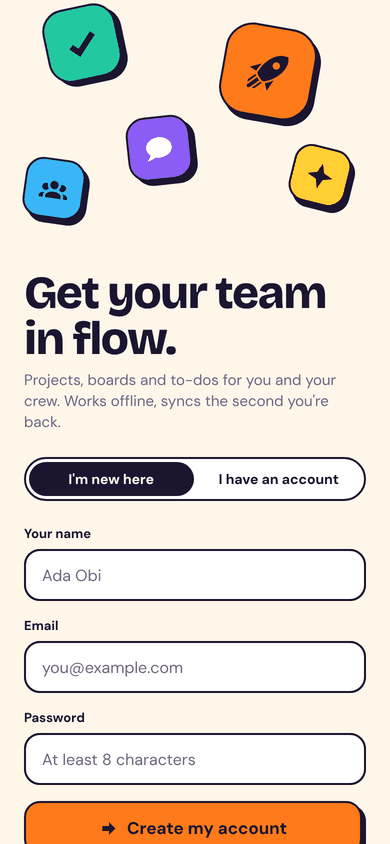
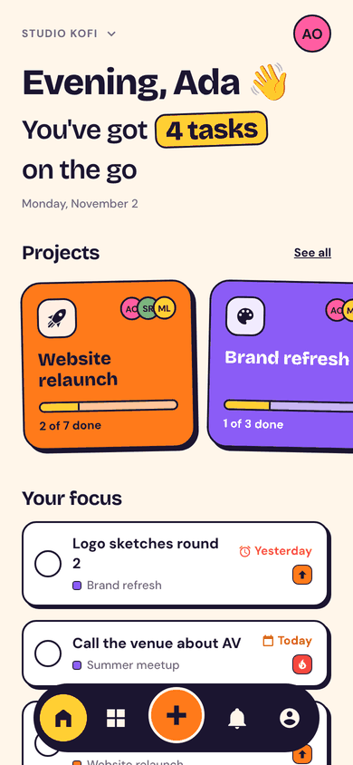
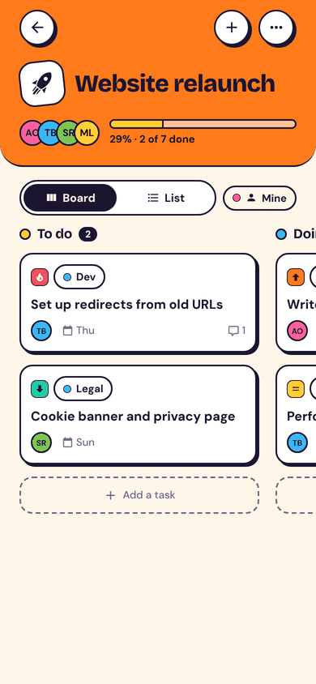
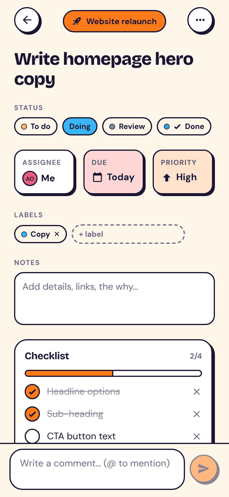
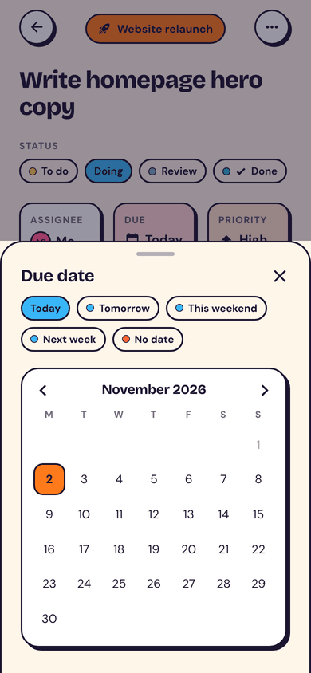
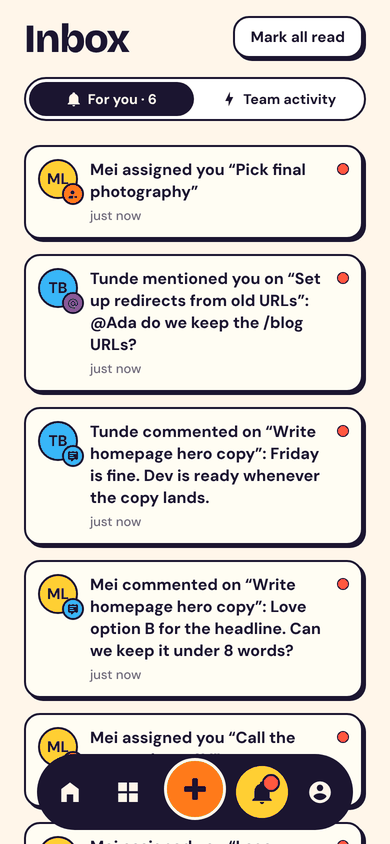
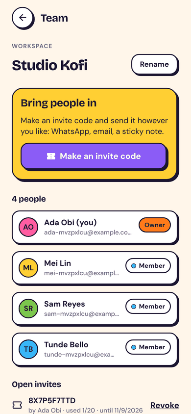
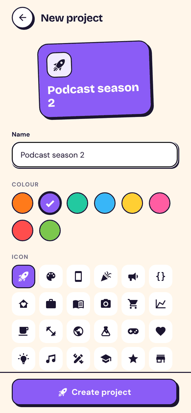
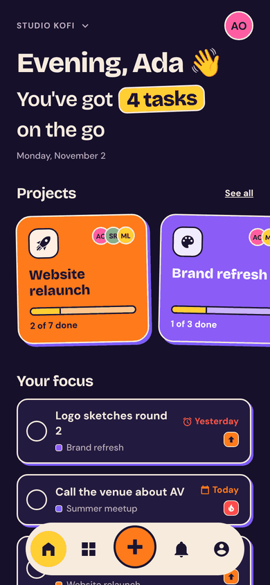
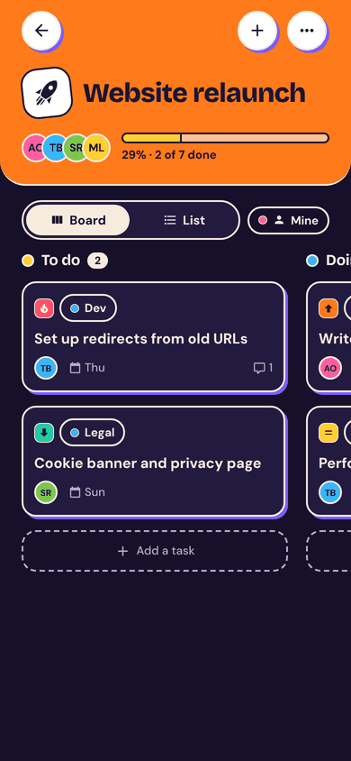

# FlowTask

FlowTask is project and task management for individuals and small teams, made for phones. Put work on boards with your own workflow columns, give tasks to teammates, and talk it through in comments with @mentions. Changes show up on everyone's phone straight away. It works offline too: changes are saved on the phone and sync the moment you're back online.

This repository has two parts:

| Folder | What it is | Built with |
|---|---|---|
| [`app/`](app) | The mobile app (Android and iOS, plus a browser build) | Expo SDK 58, React Native 0.88, Expo Router, Reanimated |
| [`server/`](server) | The API: accounts, team workspaces, sync, live updates, push | Node 22, Fastify 5, PostgreSQL 16, WebSockets |

<p>
  
  
  
  
</p>

## Contents

- [What it does](#what-it-does)
- [The look](#the-look)
- [Run it locally](#run-it-locally)
- [How sync works](#how-sync-works)
- [API](#api)
- [Security](#security)
- [Tests](#tests)
- [Deploying](#deploying)
- [Configuration](#configuration)
- [Limits](#limits)
- [Project layout](#project-layout)

## What it does

**Your day**
- **Home** greets you and counts what's on your plate. "Your focus" lists tasks assigned to you that are late, due today or in progress. "Coming up" shows what's next.
- Tap the big round checkbox to finish a task. It pops, sends a little burst of confetti and buzzes. The task moves to the project's done column for everyone.
- A floating "+" captures a new task from anywhere. You can set the project, column, who it's for, due date and priority, or just type a title and go.

**Projects and boards**
- Each project has a colour and an icon, and its colour carries through its tile, board header, tags and checkboxes.
- **Board view** shows a column per workflow step. **List view** groups the same tasks by column. A "Mine" filter shows only your tasks.
- Workflow templates: Simple, Team, Content and Bugs. You can rename, recolour, reorder, add and delete columns. When you delete a column, you choose where its tasks go. Every project keeps at least one "finished" column, which is how FlowTask knows what's done.
- Long-press a card to move it to another column or up and down. Projects can be archived and restored, or deleted.

**Tasks**
- Title, notes, column, assignee, due date, priority (urgent, high, medium, low), labels and a checklist with progress.
- The due date picker has quick choices (today, tomorrow, this weekend, next week, none) and a month calendar.
- Comments use chat bubbles, and `@` suggests teammates to mention. You can edit or delete your own comments, and admins can remove anyone's.
- Tasks can move to another project.

<p>
  
  
  
  
</p>

**Teams**
- **Workspaces** hold projects and people. One person can be in several workspaces and switch between them from Home.
- Invite people with a **10-character code** (no look-alike letters), shared however you like. Codes last 7 days and work for up to 20 people, and admins can revoke them. `flowtask://join?code=…` opens the join screen.
- Roles:
  - **Owners** do everything, including deleting the workspace.
  - **Admins** manage people and invites.
  - **Members** work on projects.
- A workspace always keeps at least one owner. Removing someone unassigns their open tasks.

**Staying in the loop**
- **Inbox → For you**: when you're assigned a task, someone comments on a task that's yours, you're @mentioned, or a task you created is finished.
- **Inbox → Team activity**: everything happening in the workspace.
- **Push notifications** for the same events. Tapping one opens the task, even in another workspace.
- **Live updates**: a teammate's change appears on your screen within a second, without pulling to refresh.

**Your account**
- Change your name, avatar colour and password. Changing the password signs out your other devices.
- **Delete your account** (both app stores require this). Workspaces where you're alone are deleted. Your work in shared workspaces stays, credited to "Deleted user".
- Point the app at your own server from the sign-in screen.

## The look

The style is bold and playful:
- **Shapes and colour:** a warm cream page, ink outlines, and hard offset shadows that buttons sink into when pressed. There are eight saturated colours (tangerine, grape, mint, sky, lemon, bubblegum, tomato, leaf).
- **Type:** Bricolage Grotesque for headings, DM Sans for everything else.
- **Motion:** floating shapes on the welcome screen, checkboxes that spring with confetti, animated progress bars, and haptics on taps.
- **Dark mode:** a deep purple background with cream outlines and violet shadows.

All of this lives in [`app/src/ui/theme.ts`](app/src/ui/theme.ts) and [`app/src/ui/kit.tsx`](app/src/ui/kit.tsx).

<p>
  
  
</p>

## Run it locally

You need Node 22.13+ and PostgreSQL 16 (or Docker).

```bash
# 1. The API (creates its tables on first start)
createdb flowtask
cd server
npm ci
npm start                      # http://localhost:4000
#   or, with Docker:  docker compose up --build   (from the repo root)

# 2. The app
cd app
npm ci
npm start                      # scan the QR code with Expo Go
```

On a real phone, `localhost` is the phone itself. Tell the app where the API is with your computer's network address: `EXPO_PUBLIC_API_URL=http://192.168.1.20:4000 npm start`. You can also tap "Server: … · change" on the sign-in screen.

Every native module FlowTask uses is in Expo Go. Push notifications need a development or store build with an EAS project id; everything else works in Expo Go. `npm run web` opens the same app in a browser.

**First run.** Sign up, then start a workspace. It comes with a short "Getting started" project written as tasks. To try it as a team, make an invite code on the Team screen and sign up as a second person in another browser or on another phone.

## How sync works

```
 Phone                                       Server
 ─────                                       ──────
 tap ─► change goes in the outbox ─┐
        (saved on the phone,       │  POST /sync/push   ┌─ each change: check access, lock the
        shown immediately)         └───────────────────►│  workspace, apply, log activity,
                                                         │  queue notifications, NOTIFY
 view = server copy + outbox  ◄── GET /workspaces/:id/sync?since=cursor ◄─┘
                                        ▲
   WebSocket /live  ◄── "changed" ──────┘ (Postgres LISTEN/NOTIFY, so any server instance can tell any phone)
```

- **Offline first.** A change goes into an outbox stored on the phone, and the screen shows server data with the outbox replayed on top. So your edit appears instantly, survives the app closing, and waits patiently while you're offline. The app retries with backoff and shows an "Offline · 2 changes waiting" pill.
- **IDs are made on the phone** (UUIDs), so you can create a project and fill it with tasks while offline.
- **Idempotent.** Every change has its own id, and the server remembers which ones it has applied. A retry after a dropped connection never applies twice, and a refused change gets the same answer on every retry.
- **Pull by cursor.** Every row carries a version from one Postgres sequence, bumped on each update by a trigger. The phone asks for "everything after version N" and gets updates and deletions in one go.
  - Writes to a workspace hold an advisory lock for that workspace, so versions there become visible in order. A pull can't skip a change that was still committing.
- **The server wins.** Accepted changes stay in the outbox until the next pull confirms them, so nothing flickers. If the server refuses a change (say the task was deleted, or you lost access), it's dropped and the reason is shown.
- **Live.** The phone keeps a WebSocket open, signed in with its token. The socket only ever carries "workspace X changed". The data itself comes through the normal, permission-checked pull. The app also syncs when it comes to the foreground and every 30 seconds as a fallback.

## API

All endpoints take and return JSON. Sign in with `Authorization: Bearer <token>`.

| Endpoint | What it does |
|---|---|
| `POST /auth/signup`, `POST /auth/login`, `POST /auth/logout` | Accounts and sessions |
| `GET /me`, `PATCH /me`, `POST /me/password`, `DELETE /me` | Profile, password, account deletion |
| `POST /me/push-tokens`, `DELETE /me/push-tokens/:token` | Register a phone for push |
| `GET /workspaces`, `POST /workspaces`, `PATCH /workspaces/:id`, `DELETE /workspaces/:id` | Workspaces |
| `POST /workspaces/:id/invites`, `GET …/invites`, `DELETE …/invites/:code` | Invite codes |
| `GET /invites/:code`, `POST /invites/:code/accept` | Preview and join |
| `PATCH /workspaces/:id/members/:userId`, `DELETE …/members/:userId` | Roles, removing people, leaving |
| `GET /workspaces/:id/sync?since=N` | Everything that changed after cursor N |
| `POST /sync/push` | Apply up to 200 changes; per-change results |
| `GET /notifications`, `POST /notifications/read` | Inbox |
| `GET /live` (WebSocket) | `{type:"auth",token}`, then `{type:"subscribe",workspaceIds}`; receives `{type:"changed",workspaceId}` |
| `GET /health` | Database check |

The changes you can push are:
- `project.create`, `project.update`, `project.delete`
- `status.upsert`, `status.delete`
- `task.create`, `task.update`, `task.delete`
- `checklist.upsert`, `checklist.delete`
- `comment.create`, `comment.update`, `comment.delete`

Each one's arguments are checked with Zod in [`server/src/sync.ts`](server/src/sync.ts).

Errors look like `{ "error": { "code": "invalid", "message": "Give the task a title", "field": "title" } }`. The message is written for people and the app shows it as is.

## Security

- **Passwords** are hashed with scrypt (N=16384, r=8, p=1). Login does the same work whether or not the account exists. Wrong passwords and sign-ups are rate limited.
- **Session tokens** are 256 random bits. Only their SHA-256 is stored. Tokens expire after 60 days (configurable), and on the phone they're kept in the iOS Keychain or Android Keystore (`expo-secure-store`).
- **Permissions.** Every change is checked against workspace membership on the server, by working out which workspace the thing it touches belongs to. Assignees must be members, columns must belong to the task's project, and only authors edit their comments. People outside a workspace get "not found", so they can't learn what exists.
- **Invite codes** use 10 characters from a 31-letter alphabet. Codes have an expiry and a use limit, can be revoked, and lookups are rate limited.
- **Responses** carry `nosniff` and `no-referrer` headers. CORS is limited to configured origins (phones don't need CORS). Request bodies are capped, and logs redact the `Authorization` header.

## Tests

```bash
cd server && npm test        # 18 API tests against a real PostgreSQL (TEST_ADMIN_DATABASE_URL)
cd app && npm test           # 12 tests of the sync model (outbox replay, merging pulls, dates, mentions)
cd app && npm run typecheck && npm run lint
cd app && npm run build:e2e && npm run test:e2e   # 4 browser journeys: app + real API + PostgreSQL
cd app && npm run export:native                    # bundles Android and iOS to catch native-only issues
```

**The API tests** cover:
- sign-up, log-in and log-out, validation and rate limits, and signing other devices out after a password change
- the starter project
- invites that run out, and access from outside a workspace
- roles, the last-owner rule and unassigning removed people
- pull since a cursor, including deletes
- idempotent push and explained rejections
- column and assignee checks, and deleting a column with a move target
- notifications for assignments, comments, mentions and completions
- mention parsing, comment permissions and account deletion
- push delivery to a fake Expo endpoint, including dropping dead tokens
- WebSocket subscriptions that only hear their own workspace

**The browser journeys** use two people on two "phones":
1. Ada starts a workspace and invites Tunde, who joins with the code. Ada gives him a task due today, and it appears on his Home live and in his inbox. He comments with @Ada, and Ada, watching the task, sees it arrive. He finishes it, Ada's screen follows, and her inbox has the mention and the finished task.
2. Ada goes offline, adds a task and sees "1 change waiting". A second device doesn't have it until Ada reconnects, and then it appears there live.
3. Deleting a column moves its tasks to the column you pick.
4. Sign-up and log-in mistakes are explained.

CI ([`.github/workflows/ci.yml`](.github/workflows/ci.yml)) runs all of these, plus `expo-doctor` and a Docker build of the API.

## Deploying

**API**
1. Run PostgreSQL 16 (managed is easiest) and back it up.
2. Build and run `server/` (`docker build -t flowtask-api server`) behind HTTPS. Set `DATABASE_URL`, and `TRUST_PROXY=true` behind a proxy. The proxy must pass WebSocket upgrades for `/live`.
3. Migrations run on start, under a lock, so several instances can start together. Live updates fan out through Postgres, so instances can be added freely. The sign-up and login rate limits are per instance; put a shared limiter in front if you run many.

**App**
1. In `app/app.json`, change `ios.bundleIdentifier` and `android.package` (the `com.flowtask.app` values are placeholders).
2. Set `EXPO_PUBLIC_API_URL` for each build profile in `app/eas.json`.
3. Push notifications:
   - Run `eas init` so the project gets an EAS project id.
   - Add your Apple push key and Firebase credentials with `eas credentials`.
   - If you turn on Expo's enhanced push security, set `EXPO_ACCESS_TOKEN` on the API.
4. Build and submit: `eas build --profile production --platform all`, then `eas submit`.
5. For the store listings, the app collects an email address, a name, and what people type into tasks and comments. All of it is stored on your server. There's no tracking and no third-party analytics, and people can delete their account in the app.

## Configuration

API settings are environment variables. [`server/.env.example`](server/.env.example) lists them all with comments. The main ones are:

| Variable | Default | Purpose |
|---|---|---|
| `DATABASE_URL` | local `flowtask` | PostgreSQL |
| `PORT` | 4000 | HTTP and WebSocket port |
| `CORS_ORIGINS` | `http://localhost:8081,…` | Browser origins allowed (the web build) |
| `TRUST_PROXY` | false | Trust `X-Forwarded-For` for rate limits |
| `SESSION_DAYS` | 60 | How long a sign-in lasts |
| `PUSH_ENABLED` / `EXPO_ACCESS_TOKEN` | true / — | Push through Expo's service |
| `WORKERS` | true | Push sending and clean-up |

The app has one setting, `EXPO_PUBLIC_API_URL`, which is the API address and can be changed at sign-in.

## Limits

- **No attachments or due-date reminders yet.** Notifications cover assignments, comments, mentions and completions.
- **Cards move by long-press menu,** not drag and drop.
- **Conflicts resolve field by field, last write wins.** If two people retitle the same task while offline, the second one to sync wins. Comments and checklist items never conflict.
- **The browser build is a preview.** It keeps its offline copy in that browser's storage.
- **Push notifications** need an EAS project and a real device; they don't work in simulators.
- **Not checked here:** this was built and tested without a phone or emulator. The app logic, API and screens are covered by the tests above, and the Android and iOS bundles build. Camera-free features like haptics and push should still be checked on a device with `eas build --profile preview`.

## Project layout

```
app/
  src/app/        screens (Expo Router): welcome, onboarding, (tabs)/home|projects|inbox|me,
                  project/[id], project/new, task/[id], new-task, team, join
  src/data/       model.ts (sync rules, pure), store.ts (state, outbox, sync, live), api.ts, storage
  src/ui/         theme, chunky components, sheets, pickers, tab bar
  test/  e2e/     unit tests; Playwright journeys (start the real API on a fresh database)
server/
  src/            app.ts, auth.ts, workspaces.ts, sync.ts, notify.ts, realtime.ts, db.ts, migrations/
  test/           API tests on PostgreSQL
compose.yaml      API + PostgreSQL
```

## Licence

MIT. See [LICENSE](LICENSE).
